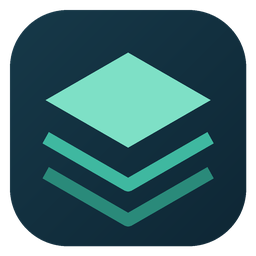

<p align="center">
  
</p>

<h1 align="center">SKYLENS Map Viewer</h1>

[简体中文](README.md) | [English](README.en.md)

<p align="center">
  Explore your Cities: Skylines II city map offline, outside the game
</p>

<p align="center">
  Windows x64 · Android 8.0+ · Offline · GPL-3.0-only
</p>

---

## Overview

**SKYLENS Map Viewer** is an offline map viewer for **Cities: Skylines II**, built on [SKYLENS MAPS](https://github.com/ganjanggejang/skylens-maps). It provides Windows and Android clients for exploring city snapshots, inspecting buildings and roads, viewing city statistics, and trying experimental route planning. The applications still use the names SKYLENS and SKYLENS Desktop.

Both clients include the map interface and load city snapshots locally. You can explore your city on a computer or phone without launching the game, connecting to the internet, or uploading city data.

Use it to examine road networks, explore transit connections, compare district population and land use, or show your city on a phone. A snapshot represents **the city at the time of export**: export and import again to see later changes. The viewer cannot open game saves directly, edit your city, or write changes back to the game.

**First steps: download a client → export a snapshot from the game → import it → open the map.**

## Upstream project and documentation

This project builds on [ganjanggejang/skylens-maps (SKYLENS MAPS)](https://github.com/ganjanggejang/skylens-maps), reusing its map frontend and city data format. It adds Windows and Android clients and the extensions described below. Thanks to the original author for the map rendering and export foundation.

**For map export instructions, installation of the original mods, and use of the browser-only application, please refer to the [upstream README](https://github.com/ganjanggejang/skylens-maps#readme).**

- **Exporting in the game and opening the browser map:** upstream's “Install and use” section explains how to enable Carto and SKYLENS MAPS, export a city, and open its map. Follow the instructions for your installed mod version.
- **Using the browser-only application:** see “Map features” for the original map controls, object details, search, and route planning.
- **Running the browser application locally:** see “Develop locally” for prerequisites, export preparation, and startup commands. The two source directories in this repository contain the Windows and Android clients.

The local map server launched by the upstream game mod depends on the game and mod remaining active. This viewer imports exported snapshots so you can browse them after closing the game. Features may differ between upstream releases and this project's clients; consult the documentation for the version you use.

## Features

- **Offline map browsing:** explore your city without launching the game.
- **Snapshot import:** import snapshot ZIPs and prepared folders; Windows also supports raw export directories.
- **Map library:** import, open, rename, and delete maps. Imports create copies and do not modify the original files.
- **Interface languages:** Simplified Chinese, Korean, and English. The initial language is Simplified Chinese; change it in the sidebar.
- **Map layers:** control buildings, roads, railways, paths, waterways, districts, and transit layers for buses, trains, trams, subways, ships, and ferries.
- **Building details:** inspect exported fields such as residents, households, employees, age, gender ratio, and wages, when available.
- **Road details:** click road centerlines to inspect width, traffic volume, road category, and other properties.
- **One-way arrows:** road direction arrows appear at suitable zoom levels.
- **Public facility icons:** identify parking, schools, police, fire stations, healthcare, parks, utilities, and other facilities.
- **City statistics:** compare citywide and district data, including residents, households, employees, companies, average age, gender ratio, profits, wages, area, and population density.
- **Land-use statistics:** calculate residential, commercial, office, and industrial areas on demand instead of reading all large datasets when opening a map.
- **Experimental driving routes:** compare fastest, shortest-distance, and avoid-high-traffic options. Estimated travel times account for road `Volume` and traffic-signal nodes.
- **Experimental transit routes:** compare least-walking, fewest-transfer, and shortest-time options across buses, trains, trams, subways, ships, and ferries.
- **Subway entrances:** build an entrance index during import and consider access walking, station walking, transit segments, and total estimated time.
- **Detailed road geometry:** load road surface outlines on demand to reduce initial loading time and memory use.
- **Shared snapshot format:** import the same prepared snapshot ZIP on Windows and Android.

## Screenshots and video

Screenshots and a demonstration video will be added after recording.

## Download and installation

Download packages from **[Releases](https://github.com/jdxws/citys_skyline2_MapViewer_app/releases)**. They are distributed separately from the Windows and Android source directories.

| Platform | Download | Description |
| --- | --- | --- |
| Windows installer | [Setup.exe](https://github.com/jdxws/citys_skyline2_MapViewer_app/releases/download/v0.1.0/SKYLENS.Desktop-0.1.0-Setup.exe) | Installation wizard with a choice of installation directory |
| Windows without installation | [Portable.exe](https://github.com/jdxws/citys_skyline2_MapViewer_app/releases/download/v0.1.0/SKYLENS.Desktop-0.1.0-Portable.exe) | Launch the executable directly |
| Android | [APK](https://github.com/jdxws/citys_skyline2_MapViewer_app/releases/download/v0.1.0/SKYLENS-Android-20261106-i18n.apk) | Transfer to your phone and install |

### Windows

1. Recommended: download `Setup.exe`, complete the installation wizard, and launch the app from its shortcut.
2. Alternatively, download and run `Portable.exe` without installing. Maps and settings are still stored in the current Windows user's application data directory.
3. If SmartScreen appears, check the download source. The current packaging configuration does not enable code signing, so Windows may show an unknown publisher.

Supports 64-bit Windows 10/11. Release packages include Electron and the files needed to run the application; users do not need Node.js.

### Android

1. Download the APK.
2. Allow the browser or file manager you are using to install unknown apps in Android's settings.
3. Open the APK to install it.

Requires Android 8.0 (API 26) or later. If you already have an older test build, try updating it in place first. Uninstalling may remove the map library, so back up important snapshots before uninstalling.

## Prepare city data

Export a city snapshot from the game before opening it in the viewer:

1. Install and enable **SKYLENS MAPS** in Cities: Skylines II, following the upstream instructions and required mod dependencies.
2. Export a city snapshot as described in the upstream documentation.
3. Locate the exported ZIP, `exported_files` folder, or the snapshot under `ModsData/CityMap/snapshots/<id>`.
4. Transfer the ZIP or folder to the target device.

Windows can prepare raw `exported_files` automatically. Android accepts prepared snapshots only. Import raw exports on Windows first, then ZIP the prepared snapshot from the Windows map library and transfer it to your phone.

Find the snapshot folder containing `GeoJSON/`, `manifest.json`, and `water-mask.png` at the same level, and ZIP that folder. Do not ZIP only `GeoJSON/` or transfer the entire application directory. Your city data is not included in the APK and must be transferred and imported separately.

## Quick start

### Windows

1. Open SKYLENS Desktop.
2. Choose “Select ZIP…” or “Select folder…”, or drag the snapshot into the window.
3. Wait for the import to finish.
4. Open the map from your library.

The default map library location is:

```text
%APPDATA%\skylens-desktop\library
```

### Android

1. Open SKYLENS.
2. Choose “Select ZIP…” or “Select folder…”.
3. Wait for the import to finish. Large snapshots may take longer; keep the screen awake.
4. Open the map from your library.

On Android 11 and later, the system folder picker restricts selecting storage roots such as Downloads and directories such as `Android/data`. Select a suitable subfolder or import a ZIP instead.

### Supported import formats

| Content | Windows | Android |
| --- | --- | --- |
| Prepared snapshot ZIP | Supported | Supported |
| Prepared snapshot folder | Supported | Supported |
| A folder structure containing `dist/data` | Supported | Supported |
| `ModsData/CityMap/snapshots/<id>` | Supported | Supported when already prepared |
| Raw `exported_files` | Supported; prepared automatically | Not supported |
| A folder containing multiple snapshots | Supported | Supported; batch import |

A prepared snapshot normally contains:

```text
GeoJSON/
manifest.json
water-mask.png
```

When present, `Network_Boundary.json` is retained for the optional detailed-road layer. Other map features can still be used with centerline data alone.

## Map controls

- Drag to pan; use the mouse wheel or pinch gestures to zoom.
- Click buildings, transit stops, or road centerlines to inspect their properties.
- Use the sidebar's layer controls to show or hide map elements.
- Use the transit controls to filter transport modes and lines. Selecting a line highlights its route and stops.
- Open city statistics from the map tools to view citywide totals and calculate district land-use areas on demand.
- Detailed roads display road surface outlines. Click the centerlines to inspect properties such as width and traffic volume.
- On Android, tap the bottom sidebar handle to toggle it, drag up to expand, or drag down to collapse. You can still move the map while the sidebar is expanded.

## Route planning

Set an origin and a destination to calculate driving and public transit routes.

> **Route planning has known issues and results are for reference only.** Driving routes do not reliably recognize turning restrictions at intersections and may include turns across solid road markings that are not allowed in the game. Transit routing does not yet distinguish a line's forward and reverse travel directions along roads, so boarding directions, stop connections, and transfer suggestions may be incorrect. Check results against the game's road markings, turning rules, and actual transit directions.

Select a building or facility and set it as the origin in its details panel. Select another object and set it as the destination, then view the route-planning results. If no route is found, try two locations near connected roads or transit stops.

### Driving

- **Fastest:** estimates travel time using road speed, `Volume`, and traffic-signal nodes.
- **Shortest distance:** prioritizes a shorter total distance.
- **Avoid high traffic:** increases the cost of high-`Volume` segments to favor alternatives.

Travel times are snapshot-based estimates and do not reproduce the game's live traffic simulation.

### Public transit

- **Shortest time:** prioritizes total estimated travel time.
- **Least walking:** prioritizes less walking.
- **Fewest transfers:** prioritizes fewer transfers.

Supported modes include buses, trams, subways, trains, ships, and ferries. Subway access connects the origin to a nearby usable entrance and adds a fixed station-walking allowance; the reverse process is used at the destination. Stop dwell times are included according to transport mode.

## Build from source

### Prerequisites

- Windows 10/11 x64
- Node.js 20 or later
- JDK 17 or later
- Android SDK 34
- Optional: Android Studio

### Windows desktop

```powershell
cd skylens-desktop-source
npm install
npm test
npm start
```

This launches the Electron development application.

Build a ZIP distribution:

```powershell
npm run dist:zip
```

Build the installer and portable executable:

```powershell
npm run dist
```

Expected outputs for version 0.1.0:

```text
skylens-desktop-source/release/
  SKYLENS Desktop-0.1.0-Setup.exe
  SKYLENS Desktop-0.1.0-Portable.exe
```

The installer uses a wizard, allows changing the installation directory, and defaults to installing for the current user. The first build needs an internet connection to download npm dependencies, Electron, and NSIS tools. A successful build should still be followed by installation, launch, and uninstall checks. Additional packaging instructions are available in the [Chinese publishing guide](docs/发布与Windows安装包.md).

### Android

Build a debug APK:

```powershell
cd skylens-mobile-android-source
.\gradlew.bat :app:assembleDebug
```

Output:

```text
skylens-mobile-android-source/app/build/outputs/apk/debug/app-debug.apk
```

Install on a connected device with USB debugging enabled:

```powershell
adb install -r app/build/outputs/apk/debug/app-debug.apk
```

Alternatively, open `skylens-mobile-android-source` in Android Studio, wait for Gradle Sync, and run on a device or use the APK build menu.

The debug build uses a debug signing key for testing. Configure your own release keystore before producing a signed release build.

### Tests

Run the desktop tests with `npm test` from `skylens-desktop-source`. The Android Java core self-tests additionally require `org.json`; see the [Android README (Chinese)](skylens-mobile-android-source/README.md) for commands.

## How it works

### Windows

Electron starts a local server for each map window, listening only on `127.0.0.1`. It serves the bundled map frontend, `session.json`, and the selected snapshot.

### Android

WebView loads the virtual origin `https://appassets.androidplatform.net/`. Frontend resources come from APK assets; a local `MapRouter` intercepts requests and supplies `session.json` and snapshot files. Nonlocal requests are rejected.

Both platforms reuse the SKYLENS MAPS frontend with a local map library, offline routing, statistics panels, and road/building enhancements.

## Data and privacy

- Maps and snapshots are stored locally.
- The application does not upload city data, require an account, or depend on online map services.
- The Windows HTTP server listens only on `127.0.0.1`.
- Android map resources are served by the local request interceptor.
- Back up any snapshots you want to keep before removing the application.

## Repository layout

```text
.
├─ skylens-desktop-source/         Windows / Electron source
│  ├─ app/                         Bundled map frontend
│  ├─ scripts/                     Frontend build and feature patches
│  ├─ src/                         Electron main process and import logic
│  └─ test/                        Node.js tests
├─ skylens-mobile-android-source/  Android source
│  ├─ app/src/main/assets/web/     Bundled map frontend
│  ├─ app/src/main/java/           Native Java client and core logic
│  └─ tools/                       Core self-tests and frontend patches
├─ docs/                           Screenshots and documentation
├─ README.en.md                    English documentation
└─ README.md                       Chinese documentation
```

Local maps, exports, dependencies, build outputs, and installation packages are excluded from source commits. Download application packages from Releases.

## Known limitations

- Snapshots must come from a compatible SKYLENS MAPS export workflow.
- Large cities may require substantial memory, especially with detailed roads enabled or during land-use calculations.
- The detailed road surface layer is visual only; use road centerlines for property selection.
- Travel times are estimates based on road speeds, traffic volume, signal nodes, and fixed stop-time assumptions.
- **Incomplete turning-restriction recognition:** routes may include turns across solid markings or other movements not permitted by the game's road rules.
- **Transit travel direction is not distinguished:** forward and reverse directions along roads are not yet differentiated, which can affect boarding directions, stop connections, and transfers.
- Android device memory and WebView versions affect loading speed and the largest usable snapshot size.
- Compatibility with future game or mod versions is not guaranteed.

## FAQ

### Why can't Android import raw `exported_files`?

Android does not include the raw-export preparation workflow. Import the raw folder on Windows first, then ZIP the prepared snapshot from the map library and transfer it to your phone.

### Why does enabling detailed roads take time?

The layer reads additional road-surface data and uses more memory. Large cities may take several seconds or longer to load it for the first time.

### Why doesn't clicking a road surface show its properties?

The detailed surface layer is for display only. Click the road centerline, or disable the detailed layer, to inspect width, traffic volume, and road category.

### Why can't transit routing find a route?

Check that the snapshot includes transit routes and stops, walking connections are usable, and the subway entrance index was generated. Missing fields in different snapshot versions can affect results.

## Acknowledgments

- Original map frontend and project: [ganjanggejang/skylens-maps](https://github.com/ganjanggejang/skylens-maps)
- Map rendering: [MapLibre GL JS](https://maplibre.org/)
- Game names and trademarks belong to their respective owners.

## License

This project is licensed under GPL-3.0-only; see [LICENSE.txt](LICENSE.txt). Third-party component licenses are listed in `THIRD_PARTY_NOTICES.txt` in each client directory.

---

Issues, suggestions, and pull requests are welcome on GitHub.
